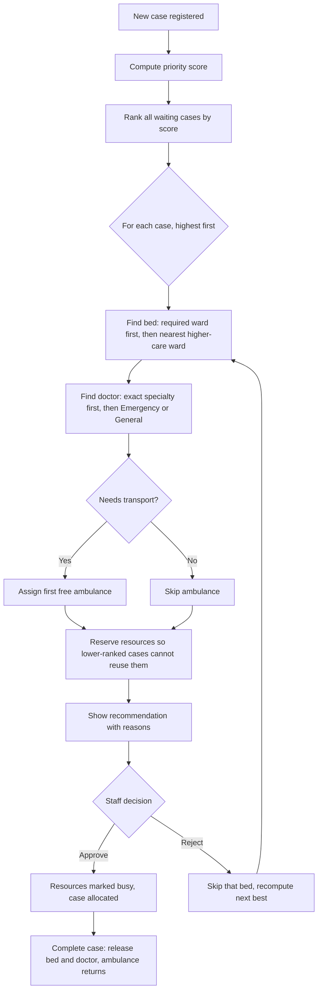
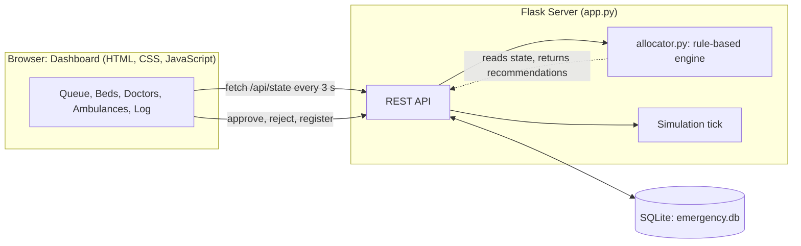

<div align="center">

# 🏥 Emergency Resource Manager

### Smart Hospital Emergency Resource Manager (HT-03)

**One screen. Every emergency case. Every bed, doctor and ambulance. A clear, explainable recommendation for who gets what, next.**

**Team Code Bite**

**Team Lead: Raju Kumar**

HealthTech Track · Hackathon 2026

</div>

---

## 📌 Table of Contents

1. [The Problem](#-the-problem)
2. [Our Solution](#-our-solution)
3. [Requirements Coverage](#-requirements-coverage)
4. [Key Features](#-key-features)
5. [How the Allocation Algorithm Works](#-how-the-allocation-algorithm-works)
6. [System Architecture](#-system-architecture)
7. [Tech Stack](#-tech-stack)
8. [Getting Started](#-getting-started)
9. [REST API Reference](#-rest-api-reference)
10. [Live Demo Walkthrough](#-live-demo-walkthrough)
11. [Safety, Ethics and Scope](#-safety-ethics-and-scope)
12. [Future Scope](#-future-scope)
13. [Team](#-team-code-bite)

---

## 🚨 The Problem

During a medical emergency, **every minute counts**, yet the information hospital staff need to act is often **scattered across different systems, whiteboards, phone calls and paper registers.**

When many patients arrive at once, staff struggle to answer four questions quickly:

| Question | Why it is hard today |
|---|---|
| **Who should be attended first?** | Priorities are judged by memory and shouting across the room, with no shared, visible ranking. |
| **Which beds are free?** | Bed status lives in one ward register, ICU status in another. Nobody sees the whole hospital. |
| **Which doctor is available and suitable?** | Availability and specialty are tracked informally. The right specialist may be free while the team looks for them. |
| **Is an ambulance available?** | Ambulance status is coordinated by calls, so it is slow and easy to get wrong. |

### The consequences

- ⏱ **Delays:** time is lost searching for resources instead of treating patients.
- ⚖️ **Inconsistent decisions:** two staff members may allocate the same bed or doctor, or overlook a waiting critical patient.
- 🔍 **No transparency:** when a decision is questioned later, there is no record of *why* it was made.
- 😰 **Staff overload:** the people with the least spare attention are asked to do the most coordination.

### The challenge we took on

> **Build an emergency management dashboard that provides a consolidated view of patient cases and available resources, helping authorized staff identify suitable allocation options.**
> (Problem statement HT-03, Smart Hospital Emergency Resource Manager)

---

## 💡 Our Solution

**Emergency Resource Manager** brings everything onto **one live dashboard**:

1. **Register** an emergency case in seconds, choosing its priority category.
2. **See** the whole hospital at a glance: beds by ward, doctors, ambulances, and the waiting queue.
3. **Get a ranked queue** where every case has a transparent priority score.
4. **Receive a recommended allocation** (bed + doctor + ambulance) for each case, with a plain-language *"Why this recommendation?"*.
5. **Approve or reject.** Staff stay in control. Rejecting instantly produces the next-best option.
6. **Release resources** when a case is completed, and the system updates for the next patient.

The system **recommends; people decide.** It is decision support, not an autopilot.

---

## ✅ Requirements Coverage

Every item of the HT-03 Expected MVP is implemented:

| # | Required by the problem statement | Status | Where |
|---|---|:---:|---|
| 1 | Register emergency cases with **configurable priority categories** | ✅ | `POST /api/cases`, `PUT /api/categories`, "Priority Categories" dialog |
| 2 | Display **available and occupied beds** using live or simulated data | ✅ | `beds` table, ward-wise bed grid, simulation mode |
| 3 | Track **doctor availability** and **ambulance status** | ✅ | `doctors` and `ambulances` tables, status toggles |
| 4 | **Recommend suitable resource allocations** based on priority and availability | ✅ | `allocator.py` |
| 5 | Show an **emergency dashboard with status updates** | ✅ | Live dashboard, stats cards, activity log (auto-refresh every 3 s) |
| ⭐ | Suggested focus: **REST APIs** | ✅ | 12 Flask endpoints |
| ⭐ | Suggested focus: **real-time dashboard** | ✅ | Polling dashboard plus live simulation |
| 🛡 | **Simulated data** and a **transparent algorithm** | ✅ | Seeded fictional data, fully explainable rules |
| 🛡 | **Human supervision** of triage and final decisions | ✅ | Approve / Reject workflow, on-screen safety notice |

---

## ✨ Key Features

### 🚦 Smart priority queue
Cases are ranked by a transparent score. The most urgent patient is always at the top, and cases waiting longer than their category allows are flagged **⚠ ESCALATED**.

### 🎛 Configurable priority categories
Hospitals differ. Rename categories, change their weight, set the maximum wait time, pick a colour, or add new categories at any time, with no code change. The ranking updates immediately.

### 🛏 Live bed map
ICU, ER, General and Isolation wards shown as a colour-coded grid (green = free, red = occupied) with a capacity bar and a **FULL** alert per ward.

### 👨‍⚕️ Doctors and 🚑 ambulances
Track availability by specialty (Emergency, Cardiology, Surgery, Pediatrics, General) and ambulance state (free, dispatched, returning). Returning ambulances become available again automatically.

### 🧠 Explainable recommendations
Every recommendation opens a **"Why this recommendation?"** panel showing the score breakdown and the reason behind each chosen bed, doctor and ambulance. There are no black boxes.

### 🙋 Human in the loop
**Approve allocation** or **Reject / next best**. Nothing is assigned until a staff member confirms.

### 📊 Operational analytics
Waiting cases, top-priority waiting, beds/doctors/ambulances free, average wait, completed cases and average time to allocation.

### 🎬 Simulation mode
One click generates new emergencies and discharges at random intervals, so the dashboard behaves like a real, busy hospital during a demo.

---

## 🧮 How the Allocation Algorithm Works

The logic lives in [`allocator.py`](allocator.py). It is rule-based, deterministic and explainable.

### Step 1: Priority score

```
score = category weight  +  waiting bonus  +  age-risk bonus

waiting bonus  = 0.5 points per minute waited (capped at 60 minutes)
age-risk bonus = +5 if the patient is under 5 or over 65
```

The waiting bonus prevents lower-priority patients from being ignored forever (starvation), and the age bonus gives a small, visible nudge to the most vulnerable.

### Step 2: Greedy allocation in rank order



### Bed fallback rules

| Case needs | Tries in this order | Notes |
|---|---|---|
| **ICU** | ICU | Never downgraded |
| **ER** | ER → ICU | Higher care is acceptable |
| **General** | General → ER → ICU | Higher care is acceptable |
| **Isolation** | Isolation | Infection control, no substitutes |

### Worked example (from the seeded demo data)

| Rank | Patient | Category | Waiting | Score breakdown | Total |
|:---:|---|---|:---:|---|:---:|
| 1 | Baby Hira (3y) | Critical | 6 min | 100 + 3.0 + 5 (age) | **108.0** |
| 2 | Ali Raza (58y) | Critical | 3 min | 100 + 1.5 + 0 | **101.5** |
| 3 | Rukhsana Bibi (71y) | Urgent | 20 min | 60 + 10.0 + 5 (age) | **75.0** |
| 4 | Kamran Shah (34y) | Urgent | 12 min | 60 + 6.0 + 0 | **66.0** |
| 5 | Zeeshan Iqbal (22y) | Semi-urgent | 25 min | 30 + 12.5 + 0 | **42.5** |

Both critical patients outrank everyone else. Baby Hira goes first because of the age-risk bonus and longer wait. Each gets a specialty-matched doctor where one is free.

---

## 🏗 System Architecture



**Design choices**

- **Server-side decisions:** allocation logic runs in Python on the server, so every client sees the same recommendation.
- **Single source of truth:** all state lives in SQLite. Reloading the page or opening a second screen shows identical data.
- **Zero external dependencies at runtime:** no paid services, no keys, no internet needed to run the demo.

### Database schema

| Table | Purpose |
|---|---|
| `categories` | Configurable priority categories (name, weight, max wait, colour) |
| `beds` | Every bed, its ward and status (free / occupied) |
| `doctors` | Doctors, specialty and status (free / busy / off) |
| `ambulances` | Ambulances and status (free / dispatched / returning) |
| `cases` | Emergency cases, lifecycle (waiting → allocated → done), assigned resources, timestamps |
| `log` | Status updates shown in the activity feed |

### Project structure

```
Emergency-Resource-Manager/
├── app.py              # Flask app, SQLite schema + seed data, REST API
├── allocator.py        # Transparent rule-based allocation engine
├── requirements.txt    # flask, gunicorn
├── README.md           # You are here
└── static/
    └── index.html      # Single-page dashboard
```

---

## 🛠 Tech Stack

| Layer | Technology |
|---|---|
| Backend | Python 3.9+, **Flask** |
| Database | **SQLite** (zero-config, file based) |
| Frontend | HTML5, CSS3 (responsive, light/dark aware), vanilla JavaScript |
| API style | RESTful JSON |
| Production server | **Gunicorn** (for deployment) |
| External services | **None** |

---

## 🚀 Getting Started

### Prerequisites
- Python 3.9 or newer

### Run locally

```bash
# 1. Clone the repository
git clone https://github.com/rajukumardeewan313-eng/Emergency-Resource-Manager.git
cd Emergency-Resource-Manager

# 2. (Optional) create a virtual environment
python -m venv venv
venv\Scripts\activate          # Windows
# source venv/bin/activate     # macOS / Linux

# 3. Install dependencies
pip install -r requirements.txt

# 4. Start the server
python app.py
```

Open **http://localhost:5000**. The database is created and filled with fictional demo data automatically on first run.

### Deploy (Render)

| Setting | Value |
|---|---|
| Build command | `pip install -r requirements.txt` |
| Start command | `gunicorn app:app --workers 1` |
| Plan | Free |

> On free hosting the database may reset after a restart. That is fine for a demo because it re-seeds automatically.

---

## 🔌 REST API Reference

| Method | Endpoint | Description |
|---|---|---|
| `GET` | `/api/state` | Full snapshot: beds, doctors, ambulances, cases, recommendations, stats and log |
| `POST` | `/api/cases` | Register a new emergency case |
| `POST` | `/api/cases/<id>/approve` | Staff approves the recommended allocation |
| `POST` | `/api/cases/<id>/reject` | Staff rejects the recommended bed; next best is computed |
| `POST` | `/api/cases/<id>/complete` | Discharge / complete a case and release resources |
| `POST` | `/api/beds/<id>/toggle` | Manually set a bed free or occupied |
| `POST` | `/api/doctors/<id>/cycle` | Cycle doctor status: free → busy → off |
| `POST` | `/api/ambulances/<id>/cycle` | Cycle ambulance status: free → dispatched → returning |
| `PUT` | `/api/categories` | Edit or add priority categories |
| `POST` | `/api/simulate/tick` | Advance the simulation by one step |
| `POST` | `/api/reset` | Reset the database to the original demo data |

**Example: register a case**

```bash
curl -X POST http://localhost:5000/api/cases \
  -H "Content-Type: application/json" \
  -d '{"name":"Test Patient","age":40,"complaint":"Chest pain","category_id":1,
       "need":"ICU","specialty":"Cardiology","transport":true}'
```

The API validates input (age range, ward, specialty, category) and returns clear error messages with proper status codes (`400`, `404`, `409`).

---

## 🎬 Live Demo Walkthrough

1. **Open the dashboard.** Point out the ranked queue, bed map, doctors, ambulances and live stats.
2. **Click "Why this recommendation?"** to show the score breakdown and reasons.
3. **Approve the top case.** Watch the bed turn red, the doctor and ambulance become busy, and the stats update.
4. **Fill the ICU** by clicking its green beds. The next ICU case now shows *"No bed available"*, so the system visibly adapts.
5. **Reject a recommendation.** The next-best bed appears instantly.
6. **Open Priority Categories** and change a weight. The queue reorders.
7. **Register a new case** with the form and watch it slot into the ranking.
8. **Turn Simulation ON** for a live, busy-hospital feel, then **Complete** a case and watch the resources return.

---

## 🛡 Safety, Ethics and Scope

- **Decision support, not diagnosis.** The system never diagnoses and does not replace clinical triage. Priority categories are assigned by staff.
- **Human approval required.** No resource is allocated until an authorized staff member clicks *Approve*.
- **Transparent by design.** Rules are simple and documented, and every recommendation explains itself.
- **Fictional data only.** All patients, doctors and ambulances are simulated. No real patient information is used.
- **Prototype limits.** There is no authentication or audit trail yet, and it is not connected to real hospital systems.

---

## 🔭 Future Scope

- 🔐 Role-based login (triage nurse, doctor, administrator) and a full audit trail
- 🔌 Integration with hospital information systems and live bed sensors
- 📡 WebSocket push updates instead of polling
- 🗺 Ambulance tracking and route/ETA estimation on a map
- 🌐 Urdu and Sindhi interface for wider accessibility
- 📈 Demand forecasting and surge-capacity planning from historical data
- 📱 Mobile-first view for staff on the move

---

## 👥 Team Code Bite

| Role | Name |
|---|---|
| **Team Lead** | **Raju Kumar** |
| Team Member 1 | **Danish Ali** |
| Team Member 2 | **Mujahid Hussain** |

<div align="center">

**Built with care by Team Code Bite for the HealthTech track.**

*Because in an emergency, clarity saves time, and time saves lives.*

</div>
